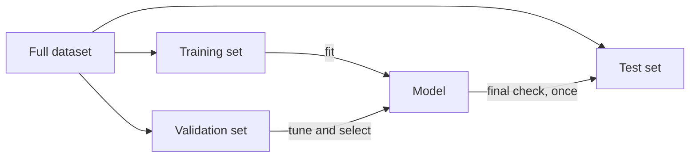

# 1.04 Dataset Splitting

## Introduction

A model that is evaluated on the same data it was trained on will look better than it really is, because it can simply memorize the examples. To estimate how a model will behave on new data, we must test it on examples it has never seen. **Dataset splitting** is the practice of dividing the available data into separate parts, each with a distinct job in the modeling process [1], [2].

Splitting looks trivial, but it is one of the places where evaluation most often goes wrong. This chapter explains the standard train, validation, and test partitions, how to choose split sizes, and which splitting strategy fits which kind of data (balanced, imbalanced, grouped, or ordered in time). Cross-validation, which reuses the data more efficiently, is covered in Chapter 1.10.

## Learning Objectives

After studying this chapter you should be able to:

- Explain the distinct roles of the training, validation, and test sets.
- Choose reasonable split proportions for datasets of different sizes.
- Apply stratified, grouped, and time-ordered splitting where appropriate.
- Estimate the statistical uncertainty of a test-set score.
- Recognize situations in which a random split gives misleadingly optimistic results.

## Fundamental Concepts

### The Three Partitions

| Partition | Purpose | Used for | Touched how often |
|-----------|---------|----------|-------------------|
| Training set | Fit the model's parameters | Learning | Many times |
| Validation set | Compare models and tune hyperparameters | Model selection | Many times |
| Test set | Give a final, unbiased performance estimate | Reporting | Once, at the very end |

The test set plays the role of future data. If it is used repeatedly to make decisions, knowledge about it gradually "leaks" into the model through those decisions, and the final score is no longer an honest estimate [1], [2].



### Choosing Split Proportions

There is no universal ratio. A classical rule of thumb for plentiful data is 50/25/25 [3], and common starting points for medium datasets are 60/20/20 or 70/15/15. With very large datasets, even 1% for validation and test can be thousands of examples, so most data can go to training. With small datasets, a fixed validation set becomes too noisy, which is a main motivation for cross-validation [1].

### Splitting Strategies

| Strategy | When to use | Key idea |
|----------|-------------|----------|
| Random split | Independent, identically distributed rows | Shuffle, then cut |
| Stratified split | Classification, especially imbalanced classes | Keep class proportions equal in every part |
| Group split | Several rows come from the same entity (patient, user) | Keep each group entirely in one part |
| Time-ordered split | Data collected over time | Train on the past, test on the future |

**Stratification.** If 5% of examples are positive, a purely random split of a small dataset can produce a test set with 2% or 9% positives. Stratified splitting preserves the 5% in every partition [2].

**Grouping.** If the same patient appears in both training and test sets, the model may recognize the patient rather than the disease. Group-aware splitting prevents this kind of leakage [2].

**Time ordering.** Shuffling time series data lets the model train on information from after the test period, which is impossible in real deployment. The test set must come strictly later than the training set [2].

### Reproducibility

Splits involve randomness. Fixing the random seed makes experiments reproducible, but a single split still reflects only one random draw; results can vary noticeably from one seed to another, particularly on small datasets [1].

## Practical Applications

The example below performs a stratified three-way split and a time-ordered split with scikit-learn.

```python
import numpy as np
from sklearn.datasets import load_breast_cancer
from sklearn.model_selection import train_test_split

X, y = load_breast_cancer(return_X_y=True)

# Step 1: hold out the test set (20%)
# Random_state: Data segmentation with code 42
X_tmp, X_test, y_tmp, y_test = train_test_split(
    X, y, test_size=0.20, stratify=y, random_state=42)

# Step 2: split the remainder into train
X_train, X_val, y_train, y_val = train_test_split(
    X_tmp, y_tmp, test_size=0.2, stratify=y_tmp, random_state=42)

for name, labels in [("train", y_train), ("val", y_val), ("test", y_test)]:
    print(name, len(labels), "positive rate:", round(labels.mean(), 3))

print (f'X_train shape: {X_train}, y_train shape: {y_train}')
print (f'X_val shape: {X_val}, y_val shape: {y_val}')
print (f'X_test shape: {X_test}, y_test shape: {y_test}')
```

Typical uses: evaluating fraud detectors on later months than they were trained on, splitting medical data by patient, and keeping rare-class proportions stable in classification benchmarks.


## Common Mistakes

- **Tuning on the test set.** If you adjust the model after seeing test scores, the test set has become a validation set and you no longer have an unbiased estimate [1].
- **Randomly splitting time series.** This allows future information into training and inflates performance.
- **Ignoring groups.** Splitting rows randomly when several rows belong to one person or device leaks identity information.
- **Splitting after preprocessing.** Fitting scalers, imputers, or feature selectors on the full dataset before splitting contaminates the test set (see Chapter 1.13).
- **Duplicate rows across partitions.** Exact or near-duplicate examples in both train and test sets make the score optimistic.
- **Reading too much into small differences.** With a small test set, a 1 to 2 point gap is often within the standard error.

## Chapter Summary

- Training, validation, and test sets serve different purposes: fitting, selecting, and final reporting.
- The test set should be used once, at the end, to give an unbiased performance estimate.
- Use stratified splits for imbalanced classes, group splits for repeated entities, and time-ordered splits for temporal data.
- The standard error $\sqrt{\hat{p}(1-\hat{p})/n}$ shows how test-set size limits precision.
- When data is scarce, cross-validation (Chapter 1.10) replaces a single fixed validation split.

## References

[1] S. Raschka, "Model evaluation, model selection, and algorithm selection in machine learning," arXiv:1811.12808, 2020. [Online]. Available: https://arxiv.org/abs/1811.12808

[2] scikit-learn developers, "Cross-validation: evaluating estimator performance," scikit-learn User Guide, 2025. [Online]. Available: https://scikit-learn.org/stable/modules/cross_validation.html

[3] T. Hastie, R. Tibshirani, and J. Friedman, *The Elements of Statistical Learning: Data Mining, Inference, and Prediction*, 2nd ed. New York, NY, USA: Springer, 2009. [Online]. Available: https://doi.org/10.1007/978-0-387-84858-7


## 🎉 Thank You for rewied
I hope this file was useful and informative for you. We always welcome your feedback and suggestion

## **CODE-LEARN-BUILD**
