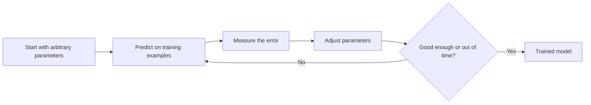

# 1.05 Model Training and Generalization

## Introduction

- Training a model means letting it learn from examples. 
- Generalization means that what it learned also works on examples it has never seen. 

The second idea is the whole point of machine learning: a model is only useful if it performs well on tomorrow's data, not just on the data it practiced with [1], [2].

## Learning Objectives

After reading this chapter you should be able to:

- Explain in plain words what happens when a model is trained.
- Distinguish training error from test error.
- Explain what generalization means and why it is the real goal.
- Name the main factors that decide whether a model generalizes.
- Explain why a model that tested well can still fail after deployment.

## Fundamental Concepts

### What Is Training?

A model starts with arbitrary internal settings, called **parameters**. Training is a repeated cycle: the model makes predictions on the training examples, a **loss function** measures how wrong those predictions are, and the parameters are adjusted slightly to reduce the loss. One full pass over the training data is called an **epoch**, and training usually takes many epochs [3].

A useful analogy is a student practicing with solved exercises: check the answer, see the mistake, adjust, try again.

### Training Error vs. Generalization Error

Continuing the analogy, imagine a student who memorizes the answers to last year's exam. They will score perfectly on last year's questions, but that score says little about how they will do on this year's exam.

| Term | Measured on | Student analogy |
|------|-------------|-----------------|
| Training error | Examples the model learned from | Score on the practice questions |
| Generalization (test) error | New examples the model has not seen | Score on the real exam |
| Generalization gap | The difference between the two | How much the practice score flatters the student |

Training error is almost always lower than test error, because the model was adjusted specifically to fit those examples. A small gap is normal. A large gap is a warning sign that the model memorized instead of learned (Chapter 1.6) [2].

### What Is Generalization?

**Generalization** is the ability to make good predictions on new data drawn from the same kind of source as the training data. A model that generalizes has captured the real pattern; a model that does not has captured the quirks and noise of its particular training set [1].

### What Decides Whether a Model Generalizes?

| Factor | Why it matters |
|--------|----------------|
| Amount of data | More examples make it harder for the model to be fooled by coincidences |
| Model complexity (capacity) | Too simple a model cannot learn the pattern; too complex a model can memorize noise |
| Representative data | New data must look like the training data, for example come from the same population and conditions |
| Built-in assumptions | Every algorithm assumes something (for instance that the relationship is roughly linear); a good match to the problem helps |

## Common Mistakes

- **Judging a model by its training score.** A high training score proves only that the model fits the examples it has seen.
- **Using the test set again and again.** If you keep adjusting the model after seeing test scores, the test set stops being "new" data.
- **Assuming more training is always better.** Training for too long can start fitting noise.
- **Forgetting that data can change.** A model that generalized last year may not generalize next year.

## Chapter Summary

- Training is a loop: predict, measure the error, adjust the parameters, repeat.
- Training error measures fit to seen data; test error estimates performance on new data.
- Generalization, performing well on unseen data, is the real goal of machine learning.
- It depends on enough data, a suitable model complexity, and training data that resembles future data.
- A good test score can still mislead when examples are not independent or when the data distribution changes later.

## References

[1] P. Domingos, "A few useful things to know about machine learning," *Communications of the ACM*, vol. 55, no. 10, pp. 78-87, 2012. [Online]. Available: https://doi.org/10.1145/2347736.2347755

[2] Google for Developers, "Machine Learning Crash Course: Generalization," 2025. [Online]. Available: https://developers.google.com/machine-learning/crash-course/overfitting/generalization

[3] T. Ma and A. Ng, "CS229 Lecture Notes," Stanford University, 2026. [Online]. Available: https://cs229.stanford.edu/notes2026spring/main_notes.pdf

## 🎉 Thank You for rewied
I hope this file was useful and informative for you. We always welcome your feedback and suggestion

## **CODE-LEARN-BUILD**
