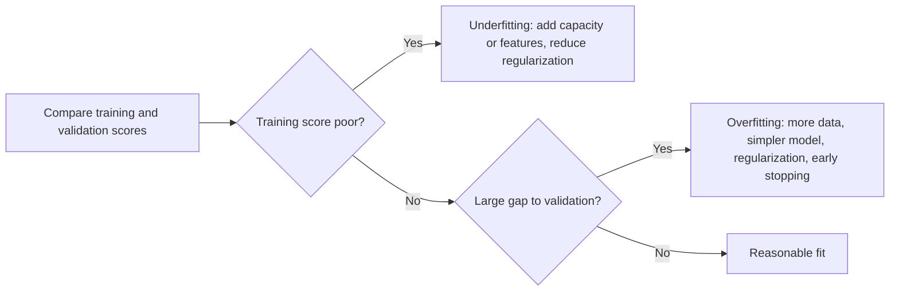

# 1.06 Overfitting and Underfitting

## Introduction

A good model captures the real pattern in the data without memorizing the noise. Two opposite failures prevent this. **Underfitting** occurs when a model is too simple to capture the pattern, so it performs poorly even on the training data. **Overfitting** occurs when a model matches the training data so closely, noise included, that it performs poorly on new data [1], [2].

Domingos identifies overfitting as one of the most persistent problems in applied machine learning, because it is a frequent reason a promising model fails in practice [2]. This chapter explains how to recognize each problem from performance curves, what causes them, and the standard remedies. The mathematical explanation in terms of bias and variance follows in Chapter 1.7, and the most important remedy, regularization, in Chapter 1.8.

## Learning Objectives

After studying this chapter you should be able to:

- Define overfitting and underfitting and recognize them from training and validation scores.
- Interpret loss curves and learning curves.
- Explain the common causes of each problem.
- Choose appropriate remedies for each situation.
- Demonstrate both failures with polynomial regression of increasing degree.

## Fundamental Concepts

### The Three Regimes

| Regime | Training error | Validation error | Typical cause | Typical symptom |
|--------|---------------|------------------|---------------|-----------------|
| Underfitting | High | High (close to training error) | Model too simple, too few features, too much regularization | Poor everywhere |
| Good fit | Low | Low (small gap) | Capacity matched to the problem | Balanced performance |
| Overfitting | Very low | Much higher | Model too complex for the data, too little data, noisy features | Large gap between training and validation |

### Diagnosing from Curves

Two plots are especially useful [1], [3]:

- **Loss (or generalization) curves** plot training and validation loss against training iterations. If validation loss starts rising while training loss keeps falling, the model has begun to overfit.
- **Learning curves** plot training and validation scores against the training set size. In underfitting, both curves converge to a poor score, so adding data will not help. In overfitting, a large gap remains, and more data typically narrows it.

### Causes of Overfitting

Overfitting arises when the model has more flexibility than the data can constrain. Typical causes are a training set that is too small or unrepresentative, too many features relative to examples, noisy or mislabeled data, a model class that is too flexible, and training for too many iterations [1], [2]. A subtle form arises from repeated testing: if you try many models and keep the best-looking one on a fixed validation set, you may select one that is lucky rather than good.

### Causes of Underfitting

Underfitting results from a model class that cannot represent the true relationship (fitting a straight line to a curved pattern), from features that do not carry enough information, from excessive regularization, or from stopping training too early [3].

### View of overfitting, underfitting and good fit

### Remedies

| Problem | Remedies |
|---------|----------|
| Underfitting | Use a more flexible model; add or engineer features; reduce regularization; train longer |
| Overfitting | Collect more data; simplify the model; remove noisy features; add regularization (Chapter 1.8); use early stopping; use cross-validation to detect it early |

The goal is not to eliminate the gap entirely. A small gap is normal, and aggressive simplification to remove it can push the model into underfitting [2].

## Advantages and Limitations

Understanding this trade-off is useful, but each diagnostic has limits.

| Strengths of the diagnostic approach | Limitations |
|--------------------------------------|-------------|
| Simple and visual: compare two scores or two curves | Curves from a single split can be noisy, particularly with small data |
| Guides concrete actions (more data, simpler model, more features) | Noisy labels can mimic overfitting or underfitting |
| Applies to any supervised model | Some modern models overfit in non-classical ways, which a simple U-curve does not capture (see Chapter 1.7) |
| Works with cheap tools such as cross-validation | The right amount of complexity still has to be found empirically |

## Common Mistakes

- **Diagnosing from training error alone.** Low training error cannot distinguish a good fit from overfitting.
- **Chasing a zero gap.** Reducing the gap by oversimplifying the model replaces overfitting with underfitting.
- **Adding more data to an underfitting model.** If the model is too simple, more data will not help; add capacity instead.
- **Selecting among many models on one validation set.** The winner may be overfit to that validation set.
- **Ignoring leakage.** An unexpectedly low training and validation error can reflect leaked information, not a good fit (see Chapter 1.13).
- **Treating noise as signal.** Fitting every wiggle in noisy data reduces training error while damaging generalization.

## Chapter Summary

- Underfitting means the model is too simple (high error everywhere); overfitting means it memorizes noise (low training error, high validation error).
- Loss curves and learning curves are the main diagnostic tools.
- Overfitting is fought with more data, simpler models, regularization, and early stopping; underfitting with more capacity, better features, and less regularization.
- Polynomial degree is a clear illustration of the capacity trade-off and the U-shaped validation curve.
- Chapter 1.7 explains the same phenomenon in terms of bias and variance.

## References

[1] Google for Developers, "Machine Learning Crash Course: Overfitting," 2025. [Online]. Available: https://developers.google.com/machine-learning/crash-course/overfitting/overfitting

[2] P. Domingos, "A few useful things to know about machine learning," *Communications of the ACM*, vol. 55, no. 10, pp. 78-87, 2012. [Online]. Available: https://doi.org/10.1145/2347736.2347755

[3] scikit-learn developers, "Underfitting vs. Overfitting," scikit-learn Examples, 2025. [Online]. Available: https://scikit-learn.org/stable/auto_examples/model_selection/plot_underfitting_overfitting.html

[4] I. Goodfellow, Y. Bengio, and A. Courville, "Machine learning basics," in *Deep Learning*. Cambridge, MA, USA: MIT Press, 2016, ch. 5. [Online]. Available: https://www.deeplearningbook.org/contents/ml.html

## 🎉 Thank You for rewied
I hope this file was useful and informative for you. We always welcome your feedback and suggestion

## **CODE-LEARN-BUILD**
