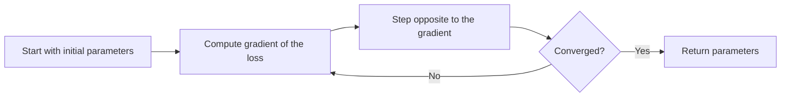

# 1.09 Gradient Descent and Optimization

## Introduction

Training a model means minimizing a loss function over its parameters. For a few simple models this minimization has a closed-form answer, but for most models, including logistic regression and neural networks, it does not. **Gradient descent** is the workhorse algorithm for these cases: it repeatedly moves the parameters a small step in the direction in which the loss decreases fastest [1], [2].

This chapter develops gradient descent from first principles, explains the roles of the learning rate and of batch size, introduces the common variants (stochastic, mini-batch, momentum, Adam), and shows how to implement the algorithm for linear regression. The same machinery reappears in the chapters on regression and classification that follow.

## Learning Objectives

After studying this chapter you should be able to:

- Explain gradient descent geometrically and write its update rule.
- Compute the gradient of the mean squared error for linear regression.
- Describe the effect of the learning rate and diagnose divergence or slow progress.
- Distinguish batch, stochastic, and mini-batch gradient descent.
- Explain momentum and adaptive methods such as Adam at a conceptual level.
- Implement gradient descent from scratch and verify it against a closed-form solution.

## Fundamental Concepts

### The Idea

Picture the loss as a landscape over the parameter space. The **gradient** at a point is a vector pointing uphill in the steepest direction. Moving in the opposite direction lowers the loss, so the algorithm takes repeated downhill steps until it reaches a (local) minimum [1], [2].

### The Learning Rate

The step size is controlled by the **learning rate** $\eta$. It is the most important hyperparameter of gradient descent [1], [3].

| Learning rate | Behavior |
|---------------|----------|
| Too small | Very slow progress; may stop far from the minimum in practice |
| Well chosen | Steady decrease of the loss |
| Slightly too large | Loss oscillates around the minimum |
| Far too large | Loss increases and the algorithm diverges |

### Batch, Stochastic, and Mini-Batch Variants

| Variant | Gradient computed from | Advantages | Disadvantages |
|---------|----------------------|------------|---------------|
| Batch | All $n$ examples | Smooth, stable steps | Slow per step on large data |
| Stochastic (SGD) | One example | Very cheap steps; can escape shallow local minima | Noisy updates |
| Mini-batch | A small subset (e.g. 32 to 256) | Balances cost and noise; efficient on hardware | Batch size becomes a hyperparameter |

Mini-batch gradient descent is the standard choice in practice [1], [3].

### Convexity and Local Minima

For a **convex** loss, such as the mean squared error of a linear model or the logistic loss, every local minimum is a global minimum, and gradient descent with a suitable learning rate converges to it. For non-convex losses, as in neural networks, there are many local minima and saddle points, and the result depends on initialization and the optimizer. In practice, good solutions are often found despite this [1], [4].

### Improving Plain Gradient Descent

- **Feature scaling.** When features have very different scales, the loss landscape forms narrow valleys and gradient descent zigzags. Standardizing features makes convergence much faster (see Chapter 1.3).
- **Momentum.** Accumulates a running average of past gradients, which damps oscillations and speeds progress along consistent directions [3].
- **Adaptive learning rates.** Methods such as AdaGrad, RMSProp, and **Adam** give each parameter its own effective step size based on the history of its gradients; Adam combines momentum with this adaptive scaling [3].
- **Learning-rate schedules.** Decrease $\eta$ over time so the algorithm takes large steps early and fine steps near the end.

## Mathematical Foundations

Let $J(\boldsymbol{\theta})$ be the loss as a function of the parameter vector $\boldsymbol{\theta}\in\mathbb{R}^m$. Its gradient is the vector of partial derivatives,

$$
\nabla J(\boldsymbol{\theta}) = \left(\frac{\partial J}{\partial\theta_1},\dots,\frac{\partial J}{\partial\theta_m}\right)^{\top}
$$

The **gradient descent update** at iteration $t$ is

$$
\boldsymbol{\theta}_{t+1} = \boldsymbol{\theta}_t - \eta\,\nabla J(\boldsymbol{\theta}_t)
$$

where $\eta>0$ is the learning rate. The reason it works: for small enough $\eta$, a first-order Taylor expansion gives $J(\boldsymbol{\theta}-\eta\nabla J)\approx J(\boldsymbol{\theta})-\eta\lVert\nabla J\rVert^2$, which is smaller than $J(\boldsymbol{\theta})$ whenever the gradient is nonzero.

**Linear regression example.** With features collected in a matrix $X\in\mathbb{R}^{n\times m}$ (including a column of ones for the intercept), targets $\mathbf{y}$, and parameters $\mathbf{w}$, the mean squared error loss is

$$
J(\mathbf{w}) = \frac{1}{n}\lVert X\mathbf{w}-\mathbf{y}\rVert_2^2
$$

and its gradient is

$$
\nabla J(\mathbf{w}) = \frac{2}{n}X^{\top}\bigl(X\mathbf{w}-\mathbf{y}\bigr)
$$

Here $X\mathbf{w}-\mathbf{y}$ is the vector of prediction errors, and multiplying by $X^{\top}$ distributes each error to the features that produced it. For this convex quadratic loss, convergence is guaranteed when $\eta < 1/L$, where $L=\tfrac{2}{n}\lambda_{\max}(X^{\top}X)$ is the largest curvature of the loss [4]. The closed-form (normal equation) solution is $\mathbf{w}^{*}=(X^{\top}X)^{-1}X^{\top}\mathbf{y}$, which gradient descent should approach.

**Stochastic and mini-batch versions** replace the full gradient by an estimate from a random subset $\mathcal{B}$ of size $b$:

$$
\boldsymbol{\theta}_{t+1}=\boldsymbol{\theta}_t-\eta\,\frac{1}{b}\sum_{i\in\mathcal{B}}\nabla L_i(\boldsymbol{\theta}_t)
$$

where $L_i$ is the loss on example $i$. The estimate is unbiased, so on average it points in the right direction, but it is noisy.

**Momentum** keeps a velocity $\mathbf{v}$:

$$
\mathbf{v}_{t+1}=\beta\,\mathbf{v}_t+\nabla J(\boldsymbol{\theta}_t), \qquad \boldsymbol{\theta}_{t+1}=\boldsymbol{\theta}_t-\eta\,\mathbf{v}_{t+1}
$$

with $\beta\in[0,1)$ (often 0.9) controlling how much past gradients persist [3].

## Advantages and Limitations

| Advantages | Limitations |
|------------|-------------|
| Works for any differentiable loss and very large models | Needs a learning rate that must be tuned |
| Memory-efficient; mini-batch versions scale to huge datasets | Slow on poorly scaled or ill-conditioned problems |
| Simple to implement and extend | May get stuck in poor local minima or saddle points on non-convex losses |
| Basis of nearly all modern deep learning | Sensitive to initialization on non-convex problems |
| Adaptive variants reduce manual tuning | Adaptive methods can generalize differently from plain SGD and still need tuning |

## Common Mistakes

- **Forgetting to scale features.** This leads to slow, zigzagging convergence.
- **Using a learning rate that is too large.** The loss grows instead of shrinking; always monitor the loss curve.
- **Stopping too early or judging convergence by a few steps.** Plot the loss and check that it has flattened.
- **Using the wrong gradient.** A sign error or missing $1/n$ factor changes the effective learning rate; verify with a numerical gradient check.
- **Not shuffling data in SGD.** Ordered data produces biased, oscillating updates.
- **Assuming a lower training loss means a better model.** Optimization success is not generalization success (Chapter 1.5).

## Chapter Summary

- Gradient descent minimizes a loss by repeatedly stepping opposite to its gradient: $\boldsymbol{\theta}\leftarrow\boldsymbol{\theta}-\eta\nabla J(\boldsymbol{\theta})$.
- The learning rate controls speed and stability; too large diverges, too small stalls.
- Batch, stochastic, and mini-batch variants trade accuracy of each step for cost; mini-batches are standard.
- Convex losses have no spurious local minima; neural-network losses are non-convex.
- Scaling features, momentum, adaptive methods such as Adam, and learning-rate schedules speed up and stabilize training.
- For linear regression, gradient descent converges to the same solution as the normal equation.

## References

[1] I. Goodfellow, Y. Bengio, and A. Courville, "Numerical computation" and "Optimization for training deep models," in *Deep Learning*. Cambridge, MA, USA: MIT Press, 2016, chs. 4 and 8. [Online]. Available: https://www.deeplearningbook.org/contents/optimization.html

[2] T. Ma and A. Ng, "CS229 Lecture Notes," Stanford University, 2026. [Online]. Available: https://cs229.stanford.edu/notes2026spring/main_notes.pdf

[3] S. Ruder, "An overview of gradient descent optimization algorithms," arXiv:1609.04747, 2016. [Online]. Available: https://arxiv.org/abs/1609.04747

[4] S. Boyd and L. Vandenberghe, *Convex Optimization*. Cambridge, U.K.: Cambridge University Press, 2004. [Online]. Available: https://web.stanford.edu/~boyd/cvxbook/

## 🎉 Thank You for rewied
I hope this file was useful and informative for you. We always welcome your feedback and suggestion

## **CODE-LEARN-BUILD**
