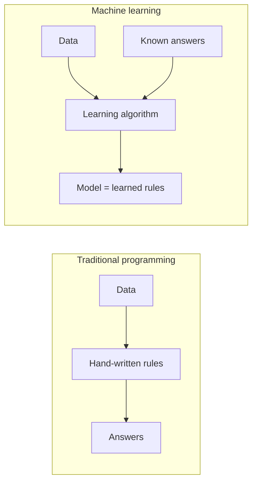
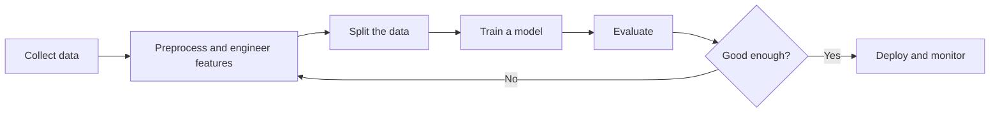

# 1.1 Introduction to Machine Learning

## Introduction

Machine learning (ML) is the study of algorithms that improve their performance on a task by learning from data rather than by following rules written by a programmer. The idea is old: Arthur Samuel described a checkers program that learned to play better than its author as early as 1959 [1]. What changed in recent decades is the amount of available data and computing power, which made learning-based systems practical for problems such as speech recognition, medical imaging, and recommendation [2].

This chapter lays the conceptual groundwork for the whole handbook. It defines machine learning, contrasts it with traditional programming, places it relative to artificial intelligence (AI) and deep learning, and introduces the four ideas that every later chapter relies on: **features**, **models**, **loss functions**, and **generalization**.

## Learning Objectives

After studying this chapter you should be able to:

- Define machine learning formally and give an everyday example.
- Explain how machine learning differs from conventional programming.
- Distinguish between AI, machine learning, and deep learning.
- Describe the roles of features, parameters, loss, and optimization in training a model.
- Explain why generalization, not training accuracy, is the real goal.
- Outline the typical stages of a machine learning project.

## Fundamental Concepts

### What Is Machine Learning?

Two classic definitions are useful. Samuel's informal one describes giving computers the ability to learn without being explicitly programmed [1], [3]. Mitchell's formal definition is more precise: a program learns from **experience** $E$ with respect to a **task** $T$ and **performance measure** $P$ if its performance on $T$, as measured by $P$, improves with $E$ [4].

| Component | Spam-filter example | House-price example |
|-----------|---------------------|---------------------|
| Task $T$ | Label an email as spam or not spam | Predict the sale price of a house |
| Experience $E$ | Emails already labeled by users | Past sales with known prices |
| Performance $P$ | Fraction of emails labeled correctly | Average prediction error in currency units |

### Machine Learning vs. Traditional Programming

In traditional programming, a developer writes the rules and the computer applies them to data to produce answers. In machine learning, the developer supplies data together with the desired answers, and the learning algorithm produces the rules, which we call the **model** [3].



This shift matters when rules are too numerous or too subtle to write by hand, such as recognizing handwriting. For simple, fully specified problems, such as applying a fixed tax formula, ordinary programming remains the better tool.

### AI, Machine Learning, and Deep Learning

These terms are nested rather than interchangeable [2].

| Term | Meaning | Example |
|------|---------|---------|
| Artificial intelligence | Any technique that lets machines perform tasks associated with intelligence | A rule-based expert system |
| Machine learning | AI methods whose behavior is learned from data | A model that predicts customer churn |
| Deep learning | ML methods based on multi-layer neural networks | An image classifier built from convolutional layers |

This handbook focuses on classical machine learning, which remains the right choice for many tabular-data problems and is the foundation for deep learning.

### The Building Blocks

**Features.** Each example is represented by a vector of measurable attributes, $\mathbf{x} = (x_1, \dots, x_m)$. A house might be described by area, number of bedrooms, and age. Choosing and transforming features is a major part of practical ML [3].

**Model and parameters.** A model is a function $f_{\boldsymbol{\theta}}$ that maps features to a prediction $\hat{y} = f_{\boldsymbol{\theta}}(\mathbf{x})$. The numbers in $\boldsymbol{\theta}$ are the **parameters** that learning adjusts.

**Loss function.** A loss $L(y, \hat{y})$ quantifies how wrong a single prediction is. Training searches for parameters that make the average loss small.

**Generalization.** The aim is good performance on new, unseen data. A model that only memorizes its training set has not learned anything useful [3].

## Mathematical Foundations

Suppose we have $n$ training examples $\{(\mathbf{x}_i, y_i)\}_{i=1}^{n}$. A linear model for house prices is

$$
\hat{y} = \mathbf{w}^{\top}\mathbf{x} + b = w_1 x_1 + w_2 x_2 + \dots + w_m x_m + b
$$

where $\mathbf{x}\in\mathbb{R}^m$ is the feature vector, $\mathbf{w}\in\mathbb{R}^m$ are the weights controlling each feature's influence, and $b$ is the intercept (baseline prediction).

The **mean squared error** (MSE) measures the average squared gap between predictions and true values:

$$
J(\mathbf{w}, b) = \frac{1}{n}\sum_{i=1}^{n}\bigl(y_i - \hat{y}_i\bigr)^2
$$

Here $y_i$ is the true target of example $i$, $\hat{y}_i$ is the model's prediction, and $n$ is the number of examples. Squaring makes all errors positive and penalizes large errors more heavily.

Learning is then an optimization problem:

$$
(\mathbf{w}^{*}, b^{*}) = \arg\min_{\mathbf{w},\, b}\; J(\mathbf{w}, b)
$$

which reads: choose the parameters that minimize the loss on the training data. Chapter 1.9 explains the standard algorithm for solving it. Because this minimizes error on *training* data only, Chapters 1.5 to 1.7 explain how to judge whether the solution also works on unseen data.

## Practical Applications

A typical project follows a repeating cycle:



Common application areas include recommendation systems, fraud detection, speech and language processing, medical image analysis, and demand forecasting [2].

The following minimal example learns a house-price model from six examples:

```python
import numpy as np
from sklearn.linear_model import LinearRegression

# Features: area (m^2), bedrooms, age (years); target: price (thousands)
X = np.array([[50, 1, 30], [70, 2, 20], [90, 3, 15],
              [120, 3, 10], [150, 4, 5], [80, 2, 25]])
y = np.array([150, 210, 280, 370, 460, 235])

model = LinearRegression().fit(X, y)
print("weights:", model.coef_.round(2), "intercept:", round(model.intercept_, 2))
print("prediction for [100, 3, 12]:", model.predict([[100, 3, 12]]).round(1))
```

No rule about prices was written by hand; the weights were learned from the examples.

## Advantages and Limitations

| Advantages | Limitations |
|------------|-------------|
| Handles problems where explicit rules are impractical | Quality is bounded by the quantity and quality of data |
| Finds patterns in data that humans may miss | Biased data produces biased models |
| Can be updated by retraining on new data | Complex models can be hard to interpret |
| Scales to large volumes of repetitive decisions | A model trained for one task rarely transfers to another |
| Often improves as more data becomes available | Training and maintenance can be costly |


## Chapter Summary

- Machine learning is a branch of artificial intelligence that allows computers to learn, predict, and make decisions using data and identifying patterns, relationships, and features instead of directly defining all the instructions and rules for them. Simply put, in machine learning, we try to teach the system how to use past experience and data to solve problems and deal with new data.
- A model maps features to predictions using parameters tuned by minimizing a loss function.
- The real objective is generalization to unseen data.

## References

[1] A. L. Samuel, "Some Studies in Machine Learning Using the Game of Checkers," *IBM Journal of Research and Development*, vol. 3, no. 3, pp. 210-229, 1959. [Online]. Available: https://people.csail.mit.edu/brooks/idocs/Samuel.pdf

[2] IBM, "What is machine learning?," IBM Think, 2024. [Online]. Available: https://www.ibm.com/think/topics/machine-learning

[3] P. Domingos, "A few useful things to know about machine learning," *Communications of the ACM*, vol. 55, no. 10, pp. 78-87, 2012. [Online]. Available: https://doi.org/10.1145/2347736.2347755

[4] T. M. Mitchell, *Machine Learning*. New York, NY, USA: McGraw-Hill, 1997, ISBN 978-0-07-042807-2.
