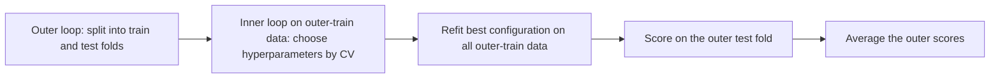

# 1.10 Model Evaluation and Cross-Validation

## Introduction

Chapter 1.4 showed that a single train/validation/test split gives only one noisy estimate of performance, and that holding out data wastes examples that could have been used for training. **Cross-validation** (CV) addresses both problems by repeatedly splitting the data, training on one part and validating on another, and averaging the results. It is the standard tool for estimating how well a modeling procedure will generalize and for comparing models when data is limited [1], [2].

This chapter explains how k-fold cross-validation works, how to choose $k$, which variants suit which kinds of data, how to report the uncertainty of a CV estimate, and how nested cross-validation separates model selection from performance estimation. The performance *metrics* computed inside each fold are the subject of Chapter 1.11.

## Learning Objectives

After studying this chapter you should be able to:

- Explain k-fold cross-validation and why it uses data more efficiently than a single split.
- Choose among k-fold, stratified, leave-one-out, repeated, group, and time-series cross-validation.
- Describe how the choice of $k$ affects bias and variance of the estimate.
- Report a cross-validated score together with its variability.
- Explain why nested cross-validation is needed when tuning and evaluating together.
- Use scikit-learn to cross-validate a pipeline correctly.

## Fundamental Concepts

### How k-Fold Cross-Validation Works

The dataset is divided into $k$ equally sized parts called **folds**. In turn, each fold serves as the validation set while the model is trained on the remaining $k-1$ folds. The $k$ validation scores are averaged to produce the cross-validation estimate. A separate test set should still be kept aside for the final evaluation [2].


Every example is used for validation exactly once and for training $k-1$ times, which makes much better use of limited data than a single holdout split [1].

### Choosing $k$

The choice trades bias against variance and computation [1], [3]:

| Choice | Bias of the estimate | Variance of the estimate | Cost |
|--------|---------------------|--------------------------|------|
| Small $k$ (e.g. 2 to 3) | Higher (models trained on much less data) | Lower | Low |
| $k=5$ or $10$ | Moderate | Moderate | Moderate |
| $k=n$ (leave-one-out) | Lowest | Often higher; folds' training sets are nearly identical | High ($n$ fits) |

Five or ten folds are the usual defaults, because they tend to give a good balance in practice [1], [3].

### Variants

| Variant | Use when | What it does |
|---------|----------|--------------|
| Stratified k-fold | Classification, especially imbalanced | Preserves class proportions in each fold |
| Repeated k-fold | You need a more stable estimate | Repeats k-fold with different random splits and averages |
| Leave-one-out (LOO) | Very small datasets | Each example is its own validation fold |
| Group k-fold | Several rows per subject or entity | Keeps each group entirely within one fold |
| Time-series split | Temporal data | Trains on the past, validates on the future in expanding windows |

### Reporting Results

A cross-validated score should be reported together with its spread, for example the mean and standard deviation across folds. The folds' scores are not fully independent, because the training sets overlap, so the naive standard error $s/\sqrt{k}$ tends to be too optimistic; treat it as a rough indication, not an exact confidence interval [1], [3]. Differences smaller than this spread should not be taken as evidence that one model is better.

### Nested Cross-Validation

If cross-validation is used both to choose hyperparameters and to report the final performance, the reported score is optimistically biased, because the winning configuration was selected for scoring well on exactly those folds. **Nested cross-validation** fixes this with two loops: an **inner loop** selects hyperparameters using only the outer training data, and an **outer loop** evaluates the whole selection procedure on data the inner loop never saw [1], [4].



### Cross-Validation in the Workflow

Cross-validation estimates the performance of a *procedure* (preprocessing plus model plus hyperparameter choice), not of one fixed fitted model. Therefore all data-dependent steps must be repeated inside each fold, which is why pipelines are used (Chapter 1.13) [2].

## Practical Applications

The example evaluates a pipeline (scaling plus logistic regression) with repeated stratified 5-fold CV, then runs nested CV to obtain an honest estimate when tuning the regularization strength `C`.

```python
import numpy as np
from sklearn.datasets import load_breast_cancer
from sklearn.model_selection import (RepeatedStratifiedKFold, StratifiedKFold,
                                     cross_val_score, GridSearchCV)
from sklearn.pipeline import make_pipeline
from sklearn.preprocessing import StandardScaler
from sklearn.linear_model import LogisticRegression

X, y = load_breast_cancer(return_X_y=True)
pipe = make_pipeline(StandardScaler(), LogisticRegression(max_iter=5000))

# 1) Repeated stratified k-fold on a fixed model
cv = RepeatedStratifiedKFold(n_splits=5, n_repeats=3, random_state=0)
scores = cross_val_score(pipe, X, y, cv=cv, scoring="accuracy")
print(f"repeated 5-fold accuracy: {scores.mean():.3f} +/- {scores.std():.3f}")

# 2) Nested CV: inner loop tunes C, outer loop estimates performance
inner = StratifiedKFold(n_splits=3, shuffle=True, random_state=1)
outer = StratifiedKFold(n_splits=5, shuffle=True, random_state=2)
search = GridSearchCV(pipe,
                      {"logisticregression__C": [0.01, 0.1, 1, 10, 100]},
                      cv=inner)
nested = cross_val_score(search, X, y, cv=outer)
print(f"nested CV accuracy:       {nested.mean():.3f} +/- {nested.std():.3f}")
```

Typical uses: comparing candidate algorithms on small datasets, choosing hyperparameters, and checking the stability of a model across different subsets of the data.

## Advantages and Limitations

| Advantages | Limitations |
|------------|-------------|
| Uses all data for both training and validation | $k$ model fits cost $k$ times as much computation |
| More stable than a single split | Estimates still vary with the random fold assignment |
| Gives a spread as well as an average | The folds are correlated, so naive standard errors are optimistic |
| Works with any model and metric | Wrong for dependent data unless group or time-series variants are used |
| Nested CV gives an honest estimate when tuning | Nested CV multiplies the computation again |

## Common Mistakes

- **Preprocessing before cross-validating.** Fitting a scaler or feature selector on all the data leaks information into every fold; put preprocessing inside a pipeline (Chapter 1.13).
- **Reporting the best CV score from a tuning search as the performance.** That value is optimistically biased; use nested CV or a separate test set [4].
- **Shuffling time series.** Use a time-series split.
- **Ignoring groups.** Rows from the same subject in both training and validation folds inflate scores.
- **Using LOO by default.** It is costly and can have high variance.
- **Over-interpreting small differences.** If two models differ by less than the fold-to-fold spread, the data does not support a preference.
- **Forgetting stratification** in imbalanced classification.

## Chapter Summary

- Cross-validation estimates generalization by rotating which part of the data is held out and averaging the scores.
- $k=5$ or $10$ is a good default; small $k$ raises bias and large $k$ raises computation and can raise variance.
- Use stratified, group, repeated, or time-series variants to match the structure of the data.
- Report the mean with a measure of spread, remembering that fold correlation makes simple standard errors optimistic.
- Nested cross-validation gives an unbiased estimate when the same data is used for tuning and evaluation.
- Always cross-validate the whole procedure, including preprocessing, inside each fold.

## References

[1] T. Hastie, R. Tibshirani, and J. Friedman, *The Elements of Statistical Learning: Data Mining, Inference, and Prediction*, 2nd ed. New York, NY, USA: Springer, 2009, ch. 7. [Online]. Available: https://doi.org/10.1007/978-0-387-84858-7

[2] scikit-learn developers, "Cross-validation: evaluating estimator performance," scikit-learn User Guide, 2025. [Online]. Available: https://scikit-learn.org/stable/modules/cross_validation.html

[3] S. Arlot and A. Celisse, "A survey of cross-validation procedures for model selection," *Statistics Surveys*, vol. 4, pp. 40-79, 2010. [Online]. Available: https://doi.org/10.1214/09-SS054

[4] S. Raschka, "Model evaluation, model selection, and algorithm selection in machine learning," arXiv:1811.12808, 2020. [Online]. Available: https://arxiv.org/abs/1811.12808

## 🎉 Thank You for rewied
I hope this file was useful and informative for you. We always welcome your feedback and suggestion

## **CODE-LEARN-BUILD**
