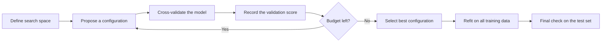

# 1.12 Hyperparameter Tuning

## Introduction

Learning algorithms have two kinds of numbers. **Parameters**, such as the coefficients of a linear model, are learned from the data during training. **Hyperparameters**, such as the regularization strength, the number of neighbors in k-nearest neighbors, or the maximum depth of a tree, are set *before* training and control how the learning happens [1], [2]. Poor hyperparameter choices can make a good algorithm perform badly, so selecting them systematically is an essential step.

This chapter explains the main search strategies (grid search, random search, and more sample-efficient approaches), why random search often beats grid search, and how to tune without fooling yourself. The evaluation machinery used inside the search, cross-validation, was covered in Chapter 1.10, and the nested form used to get honest final estimates is revisited here in the context of tuning.

## Learning Objectives

After studying this chapter you should be able to:

- Distinguish parameters from hyperparameters and give examples of each.
- Describe grid search, random search, and successive halving.
- Explain why random search is often more efficient than grid search.
- Choose appropriate search ranges and scales (linear versus logarithmic).
- Avoid optimistic bias by tuning on validation data only and using nested cross-validation.
- Run a hyperparameter search with scikit-learn.

## Fundamental Concepts

### Parameters vs. Hyperparameters

| Aspect | Parameters | Hyperparameters |
|--------|-----------|-----------------|
| Set by | The learning algorithm, from data | The practitioner, before training |
| Examples | Linear regression coefficients, tree split thresholds | Regularization $\lambda$, learning rate, $k$ in k-NN, tree depth, number of trees |
| Chosen using | Training data | Validation data or cross-validation |
| Number | Often many (thousands or millions) | Typically few (2 to 10) |

### The Tuning Procedure

Tuning is an outer search wrapped around ordinary training: propose a configuration, train the model, evaluate it on validation data (usually by cross-validation), and keep the best configuration. Finally, refit the model with that configuration on all training data and report performance on an untouched test set [1], [2].



### Search Strategies

| Strategy | How it works | Strengths | Weaknesses |
|----------|--------------|-----------|------------|
| Manual search | Practitioner tries values guided by intuition | Uses expertise; cheap for simple models | Not reproducible; hard to scale |
| Grid search | Tries every combination of a fixed list of values per hyperparameter | Exhaustive within the grid; easy to understand | Cost grows exponentially with the number of hyperparameters |
| Random search | Samples configurations at random from distributions | Explores many distinct values per hyperparameter; budget is set directly | Not guaranteed to hit the best region |
| Successive halving | Starts many configurations on small budgets and repeatedly keeps the best fraction with more budget | Saves computation on poor configurations | Early scores may mislead for slow-starting models |
| Bayesian optimization | Builds a model of score versus hyperparameters to choose promising configurations | Sample-efficient when each evaluation is expensive | More complex; sequential by nature |

### Why Random Search Often Beats Grid Search

In many problems only a few hyperparameters strongly affect performance, and which ones matter varies by dataset. A grid wastes evaluations by testing the same few values of an important hyperparameter many times (once for every combination of the unimportant ones). Random search tries a new value of *every* hyperparameter in every trial, so it explores the important dimensions more thoroughly for the same budget. Bergstra and Bengio showed empirically that random search finds models as good as or better than grid search with a fraction of the trials for several algorithms [3].

### Search Ranges and Scales

Use a **logarithmic scale** for hyperparameters that span orders of magnitude, such as regularization strengths and learning rates (for example $10^{-4}$ to $10^{2}$). Use a linear scale for quantities like the number of trees or tree depth. If the best value lies at the edge of the searched range, extend the range [1].

### Tuning Without Fooling Yourself

The best score found in a search is biased upward, because it was chosen as the maximum over many noisy estimates. Two safeguards [2], [4]:

- Keep a **test set** that the search never touches.
- Use **nested cross-validation** to estimate the performance of the *entire* tuning procedure when data is too scarce for a separate test set (Chapter 1.10).

Cawley and Talbot demonstrated that over-fitting in model selection can produce selection bias comparable in size to the differences between competing algorithms, so evaluation after heavy tuning must be done carefully [4].

## Practical Applications

The example tunes a support vector machine on the breast-cancer dataset, first with grid search and then with randomized search over log-uniform distributions, and finally estimates the honest performance with nested cross-validation.

```python
from scipy.stats import loguniform
from sklearn.datasets import load_breast_cancer
from sklearn.model_selection import (GridSearchCV, RandomizedSearchCV,
                                     StratifiedKFold, cross_val_score,
                                     train_test_split)
from sklearn.pipeline import make_pipeline
from sklearn.preprocessing import StandardScaler
from sklearn.svm import SVC

X, y = load_breast_cancer(return_X_y=True)
X_tr, X_te, y_tr, y_te = train_test_split(
    X, y, test_size=0.25, stratify=y, random_state=0)

pipe = make_pipeline(StandardScaler(), SVC())
cv = StratifiedKFold(n_splits=5, shuffle=True, random_state=0)

# Grid search: 4 x 4 = 16 configurations
grid = GridSearchCV(pipe, {
    "svc__C": [0.1, 1, 10, 100],
    "svc__gamma": [0.001, 0.01, 0.1, 1],
}, cv=cv).fit(X_tr, y_tr)
print("grid best:", grid.best_params_, "CV score:", round(grid.best_score_, 3))

# Random search: 20 random configurations on a log scale
rand = RandomizedSearchCV(pipe, {
    "svc__C": loguniform(1e-2, 1e3),
    "svc__gamma": loguniform(1e-4, 1e0),
}, n_iter=20, cv=cv, random_state=0).fit(X_tr, y_tr)
print("random best:", {k: round(float(v), 4) for k, v in rand.best_params_.items()},
      "CV score:", round(rand.best_score_, 3))

# Honest estimate: the test set was never used during the search
print("test accuracy of tuned model:", round(grid.score(X_te, y_te), 3))

# Nested CV evaluates the whole tuning procedure
nested = cross_val_score(
    GridSearchCV(pipe, {"svc__C": [0.1, 1, 10], "svc__gamma": [0.01, 0.1]}, cv=3),
    X, y, cv=StratifiedKFold(5, shuffle=True, random_state=1))
print("nested CV accuracy:", round(nested.mean(), 3))
```

Typical uses: regularization strength and kernel width for SVMs, depth and number of trees for ensembles, learning rate and batch size for neural networks, and the number of neighbors for k-NN.

## Advantages and Limitations

| Advantages | Limitations |
|------------|-------------|
| Can raise performance substantially at no change to the algorithm | Computationally expensive, especially with large grids or slow models |
| Automates what would otherwise be trial and error | The best score is optimistically biased unless evaluated carefully |
| Random search scales well to many hyperparameters | Results depend on the chosen ranges and scales |
| Reproducible when seeds and search spaces are recorded | Gains are often small compared with better data or features |
| Works with any model and metric | Over-tuning can overfit the validation data |

## Common Mistakes

- **Tuning on the test set.** Any use of test data to choose hyperparameters invalidates it as an unbiased estimate.
- **Reporting the best cross-validation score as final performance.** It is biased upward; use a held-out test set or nested CV [4].
- **Preprocessing outside the pipeline.** Scaling or feature selection fitted on all the data leaks information into every fold (Chapter 1.13).
- **Using a linear scale for quantities spanning orders of magnitude.** Regularization strengths and learning rates need log scales.
- **Searching too narrowly.** If the best value sits at the boundary of the range, the true optimum may lie outside it.
- **Tuning too many hyperparameters with too little data.** The search starts fitting noise in the validation scores.
- **Ignoring the metric.** Tune with the metric that matches the application (Chapter 1.11), not simply accuracy.

## Chapter Summary

- Hyperparameters are set before training and control the learning process; parameters are learned from data.
- Grid search is exhaustive but expensive; random search is usually more efficient, and successive halving and Bayesian methods save further computation.
- Use logarithmic scales for scale-spanning hyperparameters, and widen ranges when the best value is at an edge.
- About 59 random trials give a 95% chance of reaching the top 5% of the space, regardless of dimension.
- The best tuning score is optimistically biased; evaluate on an untouched test set or with nested cross-validation.
- Put preprocessing inside a pipeline so tuning does not leak information.

## References

[1] scikit-learn developers, "Tuning the hyper-parameters of an estimator," scikit-learn User Guide, 2025. [Online]. Available: https://scikit-learn.org/stable/modules/grid_search.html

[2] S. Raschka, "Model evaluation, model selection, and algorithm selection in machine learning," arXiv:1811.12808, 2020. [Online]. Available: https://arxiv.org/abs/1811.12808

[3] J. Bergstra and Y. Bengio, "Random search for hyper-parameter optimization," *Journal of Machine Learning Research*, vol. 13, pp. 281-305, 2012. [Online]. Available: https://jmlr.org/papers/v13/bergstra12a.html

[4] G. C. Cawley and N. L. C. Talbot, "On over-fitting in model selection and subsequent selection bias in performance evaluation," *Journal of Machine Learning Research*, vol. 11, pp. 2079-2107, 2010. [Online]. Available: https://jmlr.org/papers/v11/cawley10a.html

## 🎉 Thank You for rewied
I hope this file was useful and informative for you. We always welcome your feedback and suggestion

## **CODE-LEARN-BUILD**
