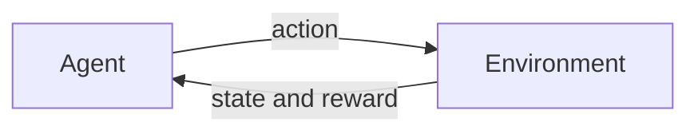

# 1.2 Types of Machine Learning

## Introduction

Machine learning methods are usually grouped by the kind of feedback available during learning. If every training example comes with the correct answer, the problem is **supervised**. If there are no answers and the goal is to find structure, it is **unsupervised**. If an agent learns by interacting with an environment and receiving rewards, it is **reinforcement learning** [1], [2]. Several hybrid settings, such as semi-supervised and self-supervised learning, sit between these categories.

Knowing which type of problem you face is the first practical decision in any project, because it determines which algorithms, data, and evaluation methods are even applicable. This chapter gives a map of the landscape; later chapters cover the main supervised and unsupervised algorithms in depth.

## Learning Objectives

After studying this chapter you should be able to:

- Distinguish supervised, unsupervised, semi-supervised, self-supervised, and reinforcement learning.
- Tell classification from regression, and clustering from dimensionality reduction.
- Choose a learning paradigm for a given problem description.
- Explain why different sources count three or four paradigms.

## Fundamental Concepts

### Supervised Learning

In supervised learning, each example is a pair $(\mathbf{x}, y)$ of input features and a known target (also called a label). The algorithm learns a mapping from inputs to targets and is then used to predict targets for new inputs [2], [3]. There are two main problem types:

| Problem type | Target $y$ | Example | Typical metrics |
|--------------|-----------|---------|-----------------|
| Classification | Discrete category | Spam or not spam; digit 0 to 9 | Accuracy, precision, recall |
| Regression | Continuous number | House price; tomorrow's temperature | MSE, MAE, $R^2$ |

### Unsupervised Learning

Here the data has only features $\mathbf{x}$ and no targets. The goal is to discover structure [3]:

- **Clustering** groups similar examples together (customer segmentation).
- **Dimensionality reduction** compresses many features into fewer informative ones (visualization, noise removal).
- **Density estimation and anomaly detection** model what normal data looks like and flag unusual points.

Because there are no correct answers to compare against, evaluating unsupervised results is harder and often relies on indirect measures or domain judgment.

### Semi-Supervised and Self-Supervised Learning

**Semi-supervised learning** uses a small labeled set together with a large unlabeled set. It is valuable when labeling is expensive, such as medical images that need expert annotation.

**Self-supervised learning** creates its own labels from the data, for example by hiding part of an input and training a model to predict it. The learned representation is then reused for downstream tasks. It underlies many modern language and vision models.

### Reinforcement Learning

In reinforcement learning (RL), an **agent** observes a **state**, takes an **action**, and receives a **reward** from the **environment**. The agent is not told the correct action; it must discover which actions lead to high cumulative reward through trial and error [4].

### Comparison of the Paradigms

| Aspect | Supervised | Unsupervised | Semi-supervised | Reinforcement |
|--------|-----------|--------------|-----------------|---------------|
| Data | Features and labels | Features only | Few labels, many unlabeled | Interaction experience |
| Feedback | Correct answer | None | Partial | Reward signal |
| Goal | Predict targets | Find structure | Predict with fewer labels | Maximize cumulative reward |
| Example | Churn | Customer segmentation | Medical image labeling | Game playing, robot control |

### Why Sources Disagree on the Count

Some introductions, such as IBM's overview [1], list three paradigms (supervised, unsupervised, reinforcement), while others add semi-supervised learning as a fourth, and newer material adds self-supervised learning. These are not contradictory: semi-supervised and self-supervised learning are best seen as variations on how labels are obtained or used. This handbook treats the first three as the core paradigms and the others as hybrids.

## Mathematical Foundations

### Supervised Objective

Given training pairs $\{(\mathbf{x}_i, y_i)\}_{i=1}^{n}$, a model class $\mathcal{Y}$, and a loss $L$, supervised learning minimizes the average training loss:

$$
\hat{Y} = \arg\min_{y\in\mathcal{Y}} \; \frac{1}{n}\sum_{i=1}^{n} L\bigl(y_i, y(\mathbf{x}_i)\bigr)
$$

where $y$ is a candidate prediction function, $\mathcal{Y}$ is the set of functions the algorithm may choose from, and $L(y, y(\mathbf{x}_i)$ penalizes the gap between the true and predicted target. For classification a common loss is the cross-entropy; for regression, the squared error.

### Unsupervised Objective: K-Means as an Example

For clustering into $K$ groups, the K-Means objective is to minimize the within-cluster sum of squares:

$$
\min_{C_1,\dots,C_K}\; \sum_{k=1}^{K}\sum_{\mathbf{x}\in C_k} \lVert \mathbf{x}-\boldsymbol{\mu}_k\rVert^{2}, \qquad \boldsymbol{\mu}_k=\frac{1}{|C_k|}\sum_{\mathbf{x}\in C_k}\mathbf{x}
$$

where $C_k$ is the set of points assigned to cluster $k$ and $\boldsymbol{\mu}_k$ is that cluster's centroid (mean). No labels appear in the formula; the objective depends only on the geometry of the data.

### Reinforcement Learning Objective

The agent chooses a policy $\pi$ that maximizes the expected **discounted return**:

$$
G_t = \sum_{k=0}^{\infty}\gamma^{k}\, r_{t+k+1}, \qquad \pi^{*}=\arg\max_{\pi}\; \mathbb{E}_{\pi}\bigl[G_t\bigr]
$$

where $r_{t+k+1}$ is the reward received $k+1$ steps after time $t$, and $\gamma\in[0,1)$ is the discount factor that makes near-term rewards count more than distant ones [4].

## Practical Applications

| Paradigm | Typical real-world uses |
|----------|-------------------------|
| Supervised | Spam filtering, credit scoring, medical diagnosis, demand forecasting |
| Unsupervised | Customer segmentation, anomaly detection, topic discovery, visualization |
| Semi-supervised | Document or image labeling with limited annotation budgets |
| Self-supervised | Pretraining language and vision models |
| Reinforcement | Game playing, robotics, resource allocation |

## Advantages and Limitations

| Paradigm | Advantages | Limitations |
|----------|-----------|-------------|
| Supervised | Clear objective; easy to evaluate | Needs labeled data, which can be costly or biased |
| Unsupervised | No labels needed; reveals hidden structure | Results are harder to validate and interpret |
| Semi-supervised | Reduces labeling cost | Depends on assumptions about how labeled and unlabeled data relate |
| Self-supervised | Exploits huge unlabeled datasets | Needs large compute; design of the pretext task matters |
| Reinforcement | Handles sequential decision making | Often sample-inefficient; reward design is difficult |

## Chapter Summary

- The type of feedback available (answers, none, or rewards) defines the learning paradigm.
- Supervised learning splits into classification (categories) and regression (numbers).
- Unsupervised learning includes clustering, dimensionality reduction, and anomaly detection.
- Semi-supervised and self-supervised learning are hybrids that change how labels are obtained.
- Reinforcement learning optimizes cumulative reward through interaction.
- Each paradigm has its own objective, data requirements, and evaluation approach.

## References

[1] IBM, "What is machine learning?," IBM Think, 2024. [Online]. Available: https://www.ibm.com/think/topics/machine-learning

[2] M. I. Jordan and T. M. Mitchell, "Machine learning: Trends, perspectives, and prospects," *Science*, vol. 349, no. 6245, pp. 255-260, 2015. [Online]. Available: https://doi.org/10.1126/science.aaa8415

[3] T. Hastie, R. Tibshirani, and J. Friedman, *The Elements of Statistical Learning: Data Mining, Inference, and Prediction*, 2nd ed. New York, NY, USA: Springer, 2009. [Online]. Available: https://doi.org/10.1007/978-0-387-84858-7

[4] R. S. Sutton and A. G. Barto, *Reinforcement Learning: An Introduction*, 2nd ed. Cambridge, MA, USA: MIT Press, 2018. [Online]. Available: http://incompleteideas.net/book/the-book-2nd.html

## 🎉 Thank You for rewied
I hope this file was useful and informative for you. We always welcome your feedback and suggestion

## **CODE-LEARN-BUILD**
