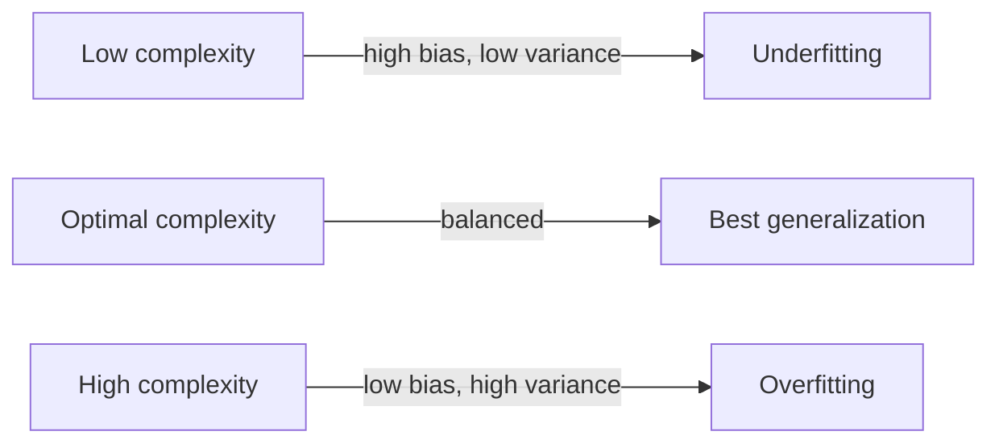

# 1.7 Bias-Variance Tradeoff

## Introduction

Chapter 1.6 described underfitting and overfitting in terms of observed error curves. The **bias-variance decomposition** explains *why* those curves look the way they do. It splits a model's expected prediction error into three parts: a systematic error caused by wrong assumptions (bias), an error caused by sensitivity to the particular training sample (variance), and an irreducible error caused by noise in the data itself [1], [2].

The classical message is that reducing bias usually increases variance, and vice versa, so good models balance the two. This view dates back at least to Geman, Bienenstock, and Doursat's analysis of neural networks [3]. More recent work has shown that very large, heavily overparameterized models can break the classical U-shaped picture [4], and this chapter explains both the classical result and its modern refinement.

## Learning Objectives

After studying this chapter you should be able to:

- Define bias, variance, and irreducible error.
- Derive the bias-variance decomposition of the squared error.
- Explain how model complexity moves a model along the bias-variance trade-off.
- Relate high bias to underfitting and high variance to overfitting.
- Estimate bias and variance empirically by simulation.
- Describe the double descent phenomenon and its limits.

## Fundamental Concepts

### Three Sources of Error

Imagine drawing many different training sets from the same process, fitting the same learning algorithm to each, and looking at the predictions for one fixed input $x$:

- **Bias** measures how far the *average* prediction is from the true value. It comes from wrong or overly restrictive assumptions, such as fitting a straight line to a curved relationship.
- **Variance** measures how much predictions *scatter* around their own average from one training set to the next. It comes from excessive sensitivity to the particular examples seen.
- **Irreducible error** (noise) is the randomness in the target itself. No model can remove it [1], [2].

| Property | High bias | High variance |
|----------|-----------|---------------|
| Model complexity | Too low | Too high |
| Training error | High | Low |
| Validation error | High | High (large gap) |
| Same as | Underfitting | Overfitting |
| Typical fix | More flexible model, better features | More data, regularization, simpler model |
| Example | Linear model on non-linear data | Very deep decision tree |

### The Trade-off

Making a model more flexible lets it follow the true pattern more closely, which lowers bias, but it also lets the model follow the quirks of the training sample, which raises variance. Total expected error is typically lowest at an intermediate complexity [1], [2].

### Practical Levers

Variance can be reduced by gathering more data, using regularization (Chapter 1.8), averaging many models (ensembles), or reducing the number of features. Bias can be reduced by choosing a richer model class or adding informative features. Model selection techniques such as cross-validation help find the balance empirically (Chapter 1.10).

### Beyond the Classical Picture

The classical U-shaped risk curve predicts that error should rise once a model is complex enough to fit the training data exactly. Yet modern practice often uses models with far more parameters than training examples, and test error for such models can decrease again after the interpolation point. This pattern, called **double descent**, was documented by Belkin and colleagues [4]. It does not make the bias-variance decomposition wrong, but it shows that "more complex always means more variance and worse generalization" is not a universal law. For the classical models in this handbook, the standard trade-off remains a reliable guide.

## Practical Applications

Because bias and variance involve averaging over many training sets, they can be estimated by simulation when the true function is known. The experiment below repeatedly samples training sets from a sine curve, fits polynomials of four degrees, and measures squared bias and variance on a fixed grid of inputs.

## Advantages and Limitations

| Advantages | Limitations |
|------------|-------------|
| Gives a precise, intuitive account of why models fail | Exact decomposition holds for squared loss only |
| Guides model complexity decisions | Bias and variance cannot be computed directly on real data, where $f$ is unknown |
| Explains why ensembles and regularization help | The classical U-curve does not describe heavily overparameterized models [4] |
| Unifies underfitting and overfitting in one framework | The "trade-off" is not always strict; some methods reduce both at once, for example with more data |

## Common Mistakes

- **Believing bias and variance can always be measured on real data.** They require knowing the true function or many independent training sets; on real data we estimate generalization error as a whole instead.
- **Equating "complex" with "bad."** Complexity is harmful only relative to the amount of data and noise.   
- **Applying the squared-loss formula to classification accuracy.** The decomposition does not carry over directly.
- **Treating the trade-off as strict.** More data lowers variance without raising bias, and good regularization can reduce total error.
- **Assuming the classical curve always applies.** Double descent shows that very large models may behave differently [4].

## Chapter Summary

- High bias corresponds to underfitting; high variance corresponds to overfitting.
- Increasing model complexity typically lowers bias and raises variance, so an intermediate complexity is often best.
- More data, regularization, and ensembling reduce variance; richer models and better features reduce bias.
- Double descent shows that the classical picture has limits for heavily overparameterized models, though it remains a good guide for classical algorithms.

## References

[1] T. Hastie, R. Tibshirani, and J. Friedman, *The Elements of Statistical Learning: Data Mining, Inference, and Prediction*, 2nd ed. New York, NY, USA: Springer, 2009, ch. 7. [Online]. Available: https://doi.org/10.1007/978-0-387-84858-7

[2] T. Ma and A. Ng, "CS229 Lecture Notes," Stanford University, 2026. [Online]. Available: https://cs229.stanford.edu/notes2026spring/main_notes.pdf

[3] S. Geman, E. Bienenstock, and R. Doursat, "Neural networks and the bias/variance dilemma," *Neural Computation*, vol. 4, no. 1, pp. 1-58, 1992. [Online]. Available: https://doi.org/10.1162/neco.1992.4.1.1

[4] M. Belkin, D. Hsu, S. Ma, and S. Mandal, "Reconciling modern machine-learning practice and the classical bias-variance trade-off," *Proceedings of the National Academy of Sciences*, vol. 116, no. 32, pp. 15849-15854, 2019. [Online]. Available: https://doi.org/10.1073/pnas.1903070116

## 🎉 Thank You for rewied
I hope this file was useful and informative for you. We always welcome your feedback and suggestion

## **CODE-LEARN-BUILD**

