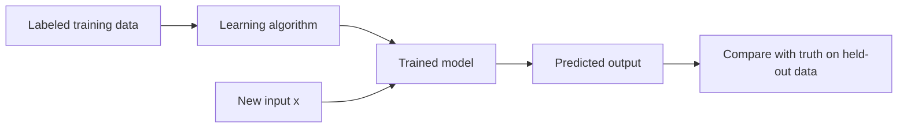

# Chapter 2: Supervised Learning?

## Introduction

Supervised learning is the branch of machine learning in which a model learns from examples that come with the correct answer. Each training example pairs an **input** (the features) with a known **output** (the label or target), and the algorithm's job is to discover a rule that maps inputs to outputs well enough to predict the output for inputs it has never seen.

Chapter 1.2 introduced supervised learning as one of several learning paradigms. This chapter and the ones that follow study it in depth. We first define the problem precisely, then split it into its two main forms, regression and classification, and finally preview the algorithms covered in the rest of the chapter.

## Fundamental Concepts

### The Supervised Learning Problem

We are given a training set of $n$ labeled examples. Each example consists of a feature vector $\mathbf{x}$ describing it and a target $y$ we want to predict. The algorithm searches a space of candidate functions for one that predicts the targets accurately, and the chosen function is then used on new inputs.

The word "supervised" reflects that the labels act as a teacher: after each prediction the algorithm can measure how wrong it was and correct itself.

### Regression and Classification

The two main problem types are distinguished by the target:

| Aspect | Regression | Classification |
|--------|-----------|----------------|
| Target $y$ | Continuous number | Discrete category |
| Output | A quantity | A class label (and often class probabilities) |
| Example | Predict the price of a house | Decide whether an email is spam |
| Typical loss | Squared error | Cross-entropy, 0-1 loss, hinge loss |
| Typical metrics | RMSE, MAE, $R^2$ | Accuracy, precision, recall, F1 |

Some algorithms (k-nearest neighbors, decision trees, support vector machines) have versions for both tasks, while others are tied to one: linear regression predicts numbers and logistic regression predicts classes.

### Algorithms in This Chapter

| Algorithm | Task | Parametric? | Discriminative or generative | Main idea |
|-----------|------|-------------|------------------------------|-----------|
| Linear regression (simple, multiple) | Regression | Yes | Discriminative | Fit a line or hyperplane by least squares |
| Polynomial regression | Regression | Yes | Discriminative | Linear model on transformed features |
| Ridge, lasso, elastic net | Regression | Yes | Discriminative | Linear model with a penalty on coefficients |
| k-nearest neighbors | Both | No | Discriminative | Predict from the closest training examples |
| Logistic regression | Classification | Yes | Discriminative | Linear model for class probabilities |
| Decision tree | Both | No | Discriminative | Sequence of feature-based questions |
| Support vector machine | Both | Yes (linear), else kernel-based | Discriminative | Maximum-margin boundary |
| Naive Bayes | Classification | Yes | Generative | Bayes' rule with independent features |

### The Supervised Workflow

A typical project: define the target and collect labeled data; preprocess it (Chapter 1.3); split it (Chapter 1.4); train candidate models; evaluate with suitable metrics (Chapters 1.10 and 1.11); tune hyperparameters (Chapter 1.12); and finally check the chosen model on an untouched test set.

Typical applications: credit scoring and fraud detection (classification), demand and price forecasting (regression), medical diagnosis (classification), and spam filtering (classification) [1].

## Next Chapter
The next chapter explores Unsupervised learning
